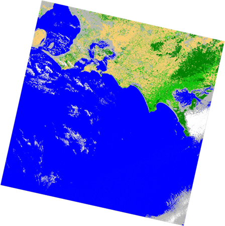
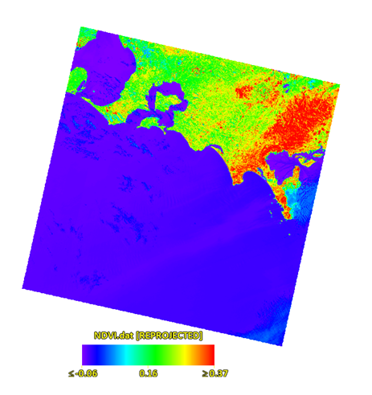
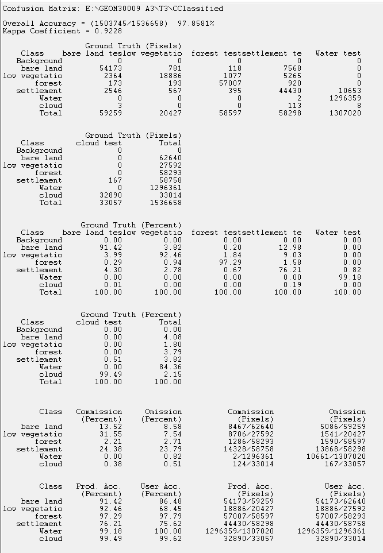

# Landsat Land-Cover Classification and Vegetation Mapping

## 中文概览

**项目定位：空间数据分析 / 遥感影像处理 / 分类与误差解释。** 使用 ENVI 处理墨尔本东南部 Landsat 8 影像，完成波段组合、影像增强、波段比值、NDVI，以及六类土地覆盖的最大似然分类。

- **个人贡献**：原团队报告明确记录，Kunze (Charlotte) Lyu 主要负责 ENVI 影像处理，并参与 Methods 和 Conclusion 撰写。其他成员负责的分析与讨论属于团队成果。
- **已有成果**：原 ENVI 混淆矩阵记录总体精度约 **97.86%**、Kappa **0.9228**；居民地类别 producer's accuracy 仅约 **76.21%**，提示总体精度掩盖了类别差异。
- **评估口径**：这些指标来自所选测试 ROI，不代表整个地区的随机抽样精度、跨地区泛化或业务应用精度。ROI 像元存在空间相关，水体样本占比较高。
- **交付范围**：团队原始结果图、个人贡献说明、方法复现步骤和结果局限。原始栅格、ROI 文件与 ENVI 工程未打包，当前不能一键重算分类。

## English documentation

An ENVI case study using Landsat 8 imagery of southeast Melbourne. The workflow combines visual enhancement, spectral indices and supervised maximum-likelihood classification into six classes: water, forest, low vegetation, settlement, bare land and cloud.

### My contribution

The submitted team report states that I was primarily responsible for conducting the ENVI image-processing tasks, with support from all group members. I also contributed to the Methods and Conclusion. The Results, Discussion and other writing remain attributed to the team. See [contribution statement](docs/CONTRIBUTIONS.md).

### Original outputs

The images are unchanged figures extracted from the team report. They are report illustrations, not georeferenced downloadable raster products. The NDVI legend in the original is small; no exact pixel values should be read from this screenshot.

### Evaluation and what it means

| Measure | Original reported result | Interpretation |
| --- | ---: | --- |
| Overall accuracy | 97.86% | Agreement with selected test ROI pixels |
| Kappa | 0.9228 | Chance-adjusted agreement on those ROIs |
| Settlement producer's accuracy | 76.21% | Recall for the selected settlement reference pixels |
| Settlement user's accuracy | 75.62% | Precision for settlement predictions on the evaluated pixels |

Water dominates the evaluated pixel population. High overall accuracy therefore coexists with weaker settlement performance. A useful follow-up is to examine settlement/bare-land/low-vegetation confusion and validate with more representative, spatially separated reference samples. No region-wide area accuracy or independent geographic generalisation is claimed.

### Workflow and reproducibility

Read the [case study](docs/CASE_STUDY.md), [manual workflow](docs/REPRODUCE.md) and [review notes](docs/REVIEW.md). ENVI was the original analysis tool; no Python reimplementation or newly trained model is claimed. Raw imagery, training/test ROI files and the ENVI project were not found in the reviewed project folder, so the processing has not been rerun.

Originally GEOM30009 Imaging the Environment, Assignment 3, University of Melbourne, 2026. This is a team coursework portfolio case study. Student numbers, course instructions and third-party reference figures are omitted. No new licence is assigned to team figures or underlying imagery.
