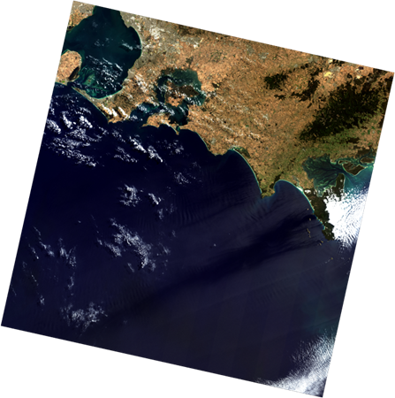
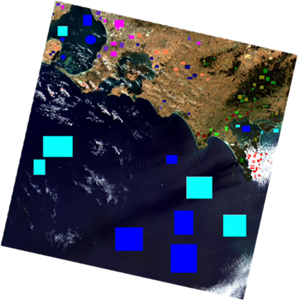

# Case study

## Question

How can spectral information distinguish vegetation, water and built surfaces in southeast Melbourne, and where does a six-class land-cover classifier confuse those surfaces?

## Inputs and methods

The original team workflow opened Landsat 8 metadata in ENVI. It examined true-colour and false-colour composites, applied linear histogram stretching for visual interpretation, and produced B2/B5 (water-related), B5/B4 (vegetation-related), and B7/B2 (soil-related) ratio images. These ratios highlight spectral contrast; they are not pure land-cover labels.

NDVI was computed from near-infrared and red bands, (B5-B4)/(B5+B4), to show vegetation contrast. Training and separate test ROIs were manually selected for water, forest, low vegetation, settlement, bare land and cloud. Maximum-likelihood classification was run on multispectral bands with the coastal aerosol band excluded, as described in the original Methods. The exact ENVI input-band configuration and ROI geometry cannot be recovered from the screenshots alone.

## Findings

The classified map distinguishes the bay and ocean, eastern forested areas, and urban/agricultural surfaces. The original assessment reports 97.86% overall ROI accuracy and Kappa 0.9228. Settlement performs less strongly (producer's accuracy 76.21%, user's accuracy 75.62%), indicating confusion with spectrally similar classes.

The overall score should be read alongside the per-class errors and evaluation sample composition. Nearby pixels are correlated, manually chosen ROIs may be easier than the full landscape, and water is heavily represented. The result is useful evidence of this workflow on its selected reference pixels, not a validated operational land-use map.

## Next checks

Recover original ROI geometry and reference labels, use spatial separation between training and validation, inspect per-class confusion, and validate a representative sample of the landscape. Quantify uncertainty before reporting areas or transferring the classifier to another scene.
